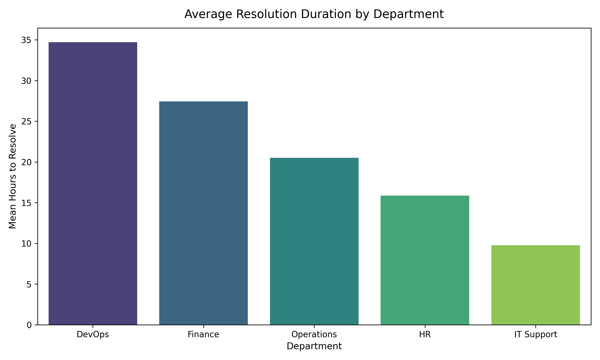

# IT Support Ticket Analytics (Python)

Modular pipeline that cleans 10,000 IT support tickets and reports resolution times by department.

**Data is synthetic.** `generate_raw_data.py` (seed 42) creates the tickets, so differences between departments (e.g. DevOps slowest) come from the generator's settings, not real operations. The point of this repo is the pipeline, not the findings.

## What it does
- `data_loader.py`: loads the CSV; clear error if the file is missing or empty
- `data_cleaning.py`: strips whitespace, drops duplicate Ticket_IDs (1 found), fills missing priorities with "Unassigned" (485 found)
- `ticket_analysis.py`: resolution hours per ticket, bucketed <4h / 4-24h / >24h
- `visualization.py`: saves 3 charts to `reports/`

## Run
pip install -r requirements.txt
python generate_raw_data.py
python main.py

Rebuilt in Sep 2026 after my original Codtech internship work (Jun-Jul 2025) was lost with my old laptop.